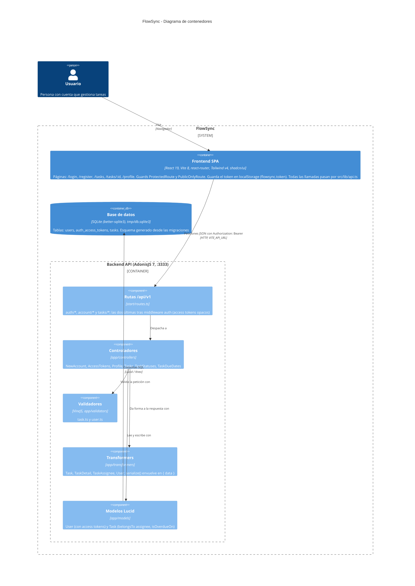

# Arquitectura de FlowSync

Diagrama de contenedores (nivel 2 de C4) de FlowSync tal y como está hoy en el código: una SPA de React que habla por HTTP/JSON con una API de AdonisJS, que persiste en un fichero SQLite. Solo aparece lo verificado en `backend/` y `frontend/`; no hay colas, cachés ni servicios externos porque no existen en el repo.

## Endpoints

| Método | Ruta | Controlador | Auth |
|---|---|---|---|
| POST | `/api/v1/auth/signup` | `NewAccountController.store` | no |
| POST | `/api/v1/auth/login` | `AccessTokensController.store` | no |
| GET | `/api/v1/account/profile` | `ProfileController.show` | sí |
| POST | `/api/v1/account/logout` | `AccessTokensController.destroy` | sí |
| GET | `/api/v1/tasks` | `TasksController.index` | sí |
| POST | `/api/v1/tasks` | `TasksController.store` | sí |
| GET | `/api/v1/tasks/:id` | `TasksController.show` | sí |
| PATCH | `/api/v1/tasks/:id/status` | `TaskStatusesController.update` | sí |
| PUT | `/api/v1/tasks/:id/due-date` | `TaskDueDatesController.update` | sí |
