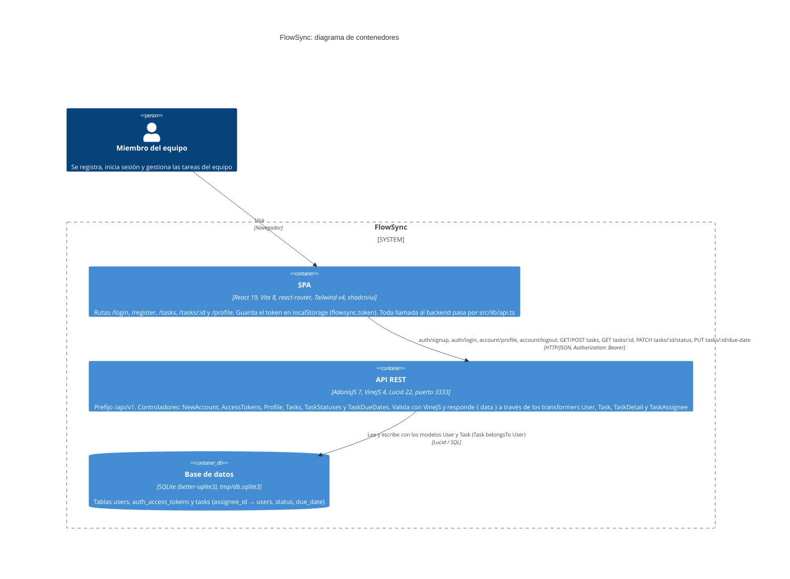

# Arquitectura de FlowSync

Diagrama de contenedores (nivel 2 de C4) de FlowSync. Muestra las tres piezas que se ejecutan por separado (la SPA de React, la API de AdonisJS y la base de datos SQLite), quién habla con quién y por qué canal. Todo lo que aparece se ha comprobado leyendo el código del repo: `backend/start/routes.ts`, `backend/app/` (controladores, modelos, transformers y validadores), `backend/database/migrations/`, `backend/config/database.ts` y `frontend/src/`. Lo que solo está configurado pero no se usa, como el guard `web` de sesión o las conexiones de Postgres/MySQL que están comentadas, no aparece.

