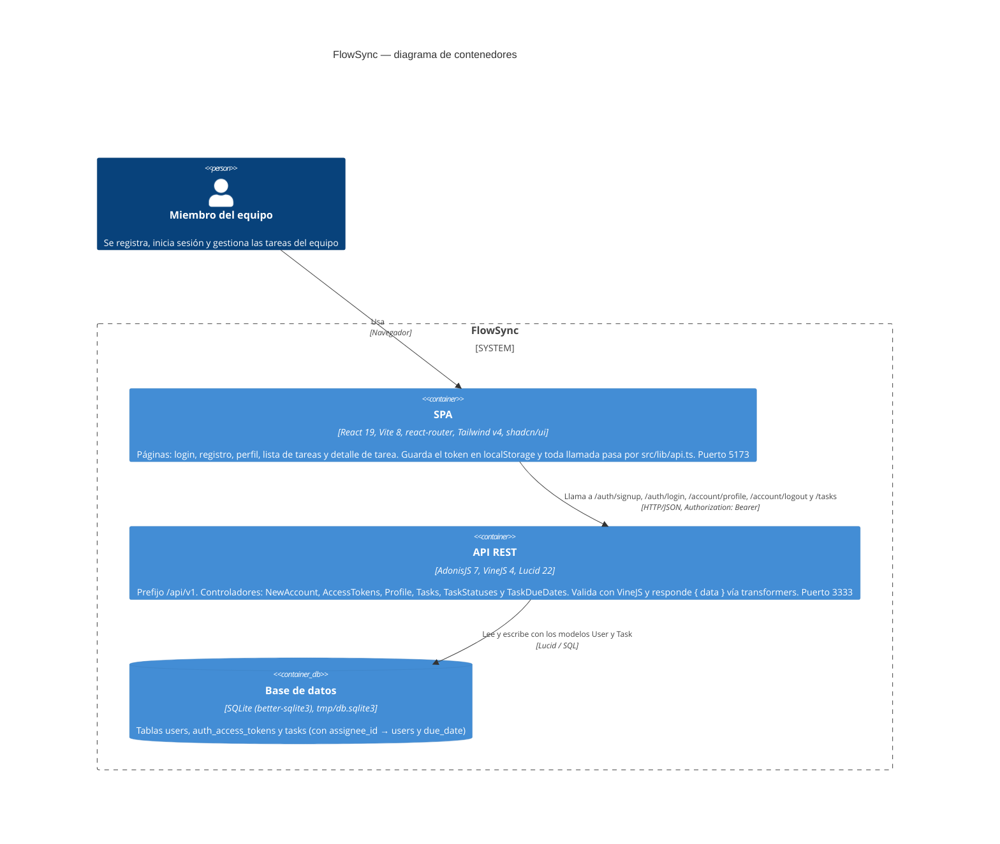

# Arquitectura de FlowSync

Diagrama de contenedores (nivel 2 de C4) de FlowSync: muestra las tres piezas que se despliegan por separado —la SPA de React, la API de AdonisJS y la base de datos SQLite—, quién habla con quién y por qué canal. Todo lo dibujado se ha comprobado leyendo el código del repo (`backend/start/routes.ts`, `backend/app/`, `backend/database/`, `frontend/src/`); lo que solo está configurado pero sin uso (el guard `web` de sesión) no aparece.

